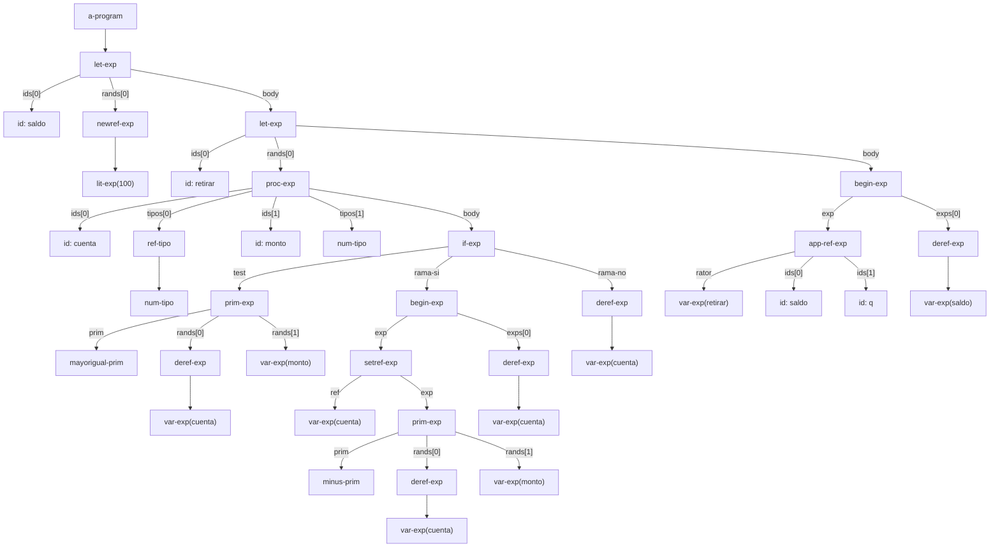
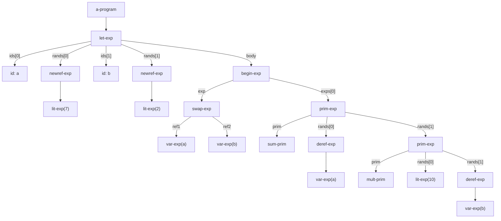
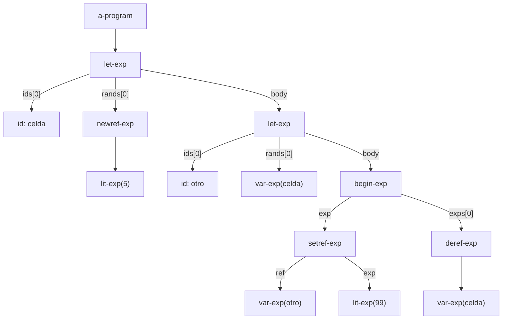
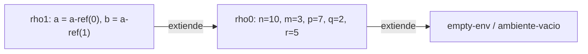
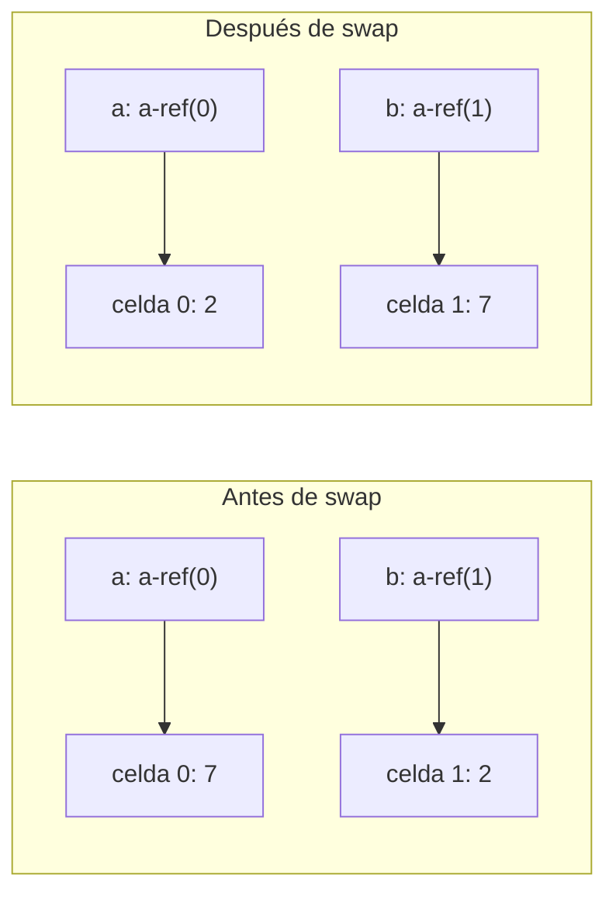
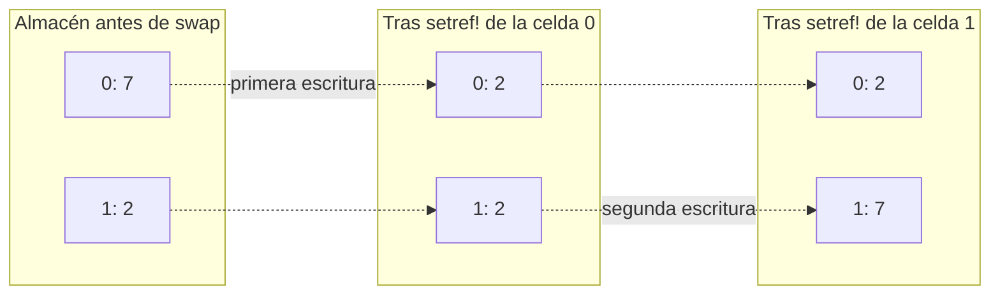

Informe de AST — Taller 3: Memoria y disciplina
Curso: Fundamentos de Interpretación y Compilación de Lenguajes de Programación — Universidad del Valle, Sede Tuluá.

Integrantes del grupo:
| Nombre completo | Código | Correo institucional |
|---|---|---|
| Andres Felipe Quiceno Gil | 2477362 | quiceno.andres@correounivalle.edu.co |
| Yonier Alejandro Vega Rojas | 2477056 | yonier.vega@correounivalle.edu.co |
| Jhon Fabricio Hurtado Marin | 2459472 | hurtado.jhoan@correounivalle.edu.co |
| Juan Esteban Aguirre Castañeda | 2459676 | juan.esteban.aguirre@correounivalle.edu.co |

1. Gramática considerada
Se utilizó la gramática de Cauca con referencias y tipos, definida en src/sintaxis.rkt mediante SLLGEN. El parser produce el datatype programa, los nodos del datatype expresion, los nodos del datatype tipo y las variantes de primitiva. Las anotaciones de tipo forman parte del AST, aunque el intérprete no las utiliza durante la evaluación.

La siguiente transcripción resume las producciones de la especificación y muestra el constructor asociado a cada una. La notación {...}* representa repetición y sep(..., s) una lista separada por s.
<programa> ::= <expresion>                              => a-program(exp)

<expresion> ::= <numero>                                => lit-exp(datum)
              | <identificador>                         => var-exp(id)
              | "true"                                  => true-exp()
              | "false"                                 => false-exp()
              | <primitiva> "(" sep(<expresion>, ",") ")" => prim-exp(prim, rands)
              | "if" <expresion> "then" <expresion>
                "else" <expresion> "end"                 => if-exp(test, rama-si, rama-no)
              | "let" {<identificador> "=" <expresion>}*
                "in" <expresion> "end"                   => let-exp(ids, rands, body)
              | "proc" "(" sep(<identificador> ":" <tipo>, ",") ")"
                <expresion> "end"                        => proc-exp(ids, tipos, body)
              | "apply" <expresion>
                "(" sep(<expresion>, ",") ")"            => app-exp(rator, rands)
              | "letrec" {<tipo> <identificador> "("
                sep(<identificador> ":" <tipo>, ",") ")"
                "=" <expresion>}*
                "in" <expresion> "end"                   => letrec-exp(tipos-res, proc-names,
                                                               idss, tipos-args, bodies, body)
              | "case" <expresion>
                {"of" <numero> "=>" <expresion>}*
                "otherwise" "=>" <expresion> "end"      => case-exp(exp-central, numeros, exps, default)
              | "newref" "(" <expresion> ")"             => newref-exp(exp)
              | "deref" "(" <expresion> ")"              => deref-exp(exp)
              | "setref" "(" <expresion> "," <expresion> ")"
                                                         => setref-exp(ref, exp)
              | "swap" "(" <expresion> "," <expresion> ")"
                                                         => swap-exp(ref1, ref2)
              | "begin" <expresion> {";" <expresion>}* "end"
                                                         => begin-exp(exp, exps)
              | "applyref" <expresion>
                "(" sep(<identificador>, ",") ")"       => app-ref-exp(rator, ids)

<tipo>      ::= "num"                                   => num-tipo()
              | "bool"                                  => bool-tipo()
              | "refto" "(" <tipo> ")"                   => ref-tipo(t)
              | "(" sep(<tipo>, "*") "->" <tipo> ")"    => proc-tipo(args, res)

<primitiva> ::= "+" | "-" | "*" | "/" | "add1" | "sub1"
              | ">" | ">=" | "<" | "<=" | "=="
              | "not" | "and" | "or" | "xor" | "implica"
              | "abs" | "mcd" | "mcm" | "promedio" | "entre"
Los constructores de primitiva, en el mismo orden en que aparecen los símbolos anteriores, son: sum-prim, minus-prim, mult-prim, div-prim, add-prim, sub-prim, mayor-prim, mayorigual-prim, menor-prim, menorigual-prim, igual-prim, not-prim, and-prim, or-prim, xor-prim, implica-prim, abs-prim, mcd-prim, mcm-prim, promedio-prim y entre-prim.

En particular, proc-exp conserva los identificadores y sus tipos en listas paralelas; por ejemplo, cuenta : refto(num) se representa mediante el identificador cuenta y el nodo ref-tipo(num-tipo()). app-ref-exp guarda una lista de identificadores, no una lista de expresiones arbitrarias.
2. Ejemplos de AST
Ejemplo 1 — Programa de retiro con referencias y tipos (Parte 4.1)
Expresión concreta solicitada:
let saldo = newref(100)
in
  let retirar = proc (cuenta : refto(num), monto : num)
    if >=(deref(cuenta), monto)
    then begin
      setref(cuenta, -(deref(cuenta), monto));
      deref(cuenta)
    end
    else deref(cuenta)
    end
  end
  in
    begin
      applyref retirar (saldo, q);
      deref(saldo)
    end
  end
end
AST completo: cada nodo correspondiente a una expresión, programa, primitiva o tipo incluye el nombre de su constructor. Las hojas con prefijo id: representan los símbolos guardados en las listas de identificadores; los números dentro de lit-exp o los nombres dentro de var-exp son sus campos.

Explicación: el programa comienza con a-program, cuyo cuerpo es un let-exp que asocia saldo con newref-exp(lit-exp(100)). El siguiente let-exp asocia retirar con un proc-exp de dos parámetros. Sus anotaciones forman parte del árbol: ref-tipo(num-tipo()) para cuenta y num-tipo() para monto. El cuerpo del procedimiento es un if-exp; su condición es prim-exp con mayorigual-prim, y su rama verdadera es un begin-exp con setref-exp y deref-exp. Por último, el begin-exp exterior contiene app-ref-exp y deref-exp.

Por qué el programa no pasa el chequeador: en el ambiente inicial, q vale 2 y tiene tipo num, mientras que saldo tiene tipo refto(num). El procedimiento retirar declara cuenta : refto(num) y monto : num, pero la regla de applyref exige que todos los parámetros sean de tipo referencia y que los identificadores enviados tengan los tipos correspondientes. En src/chequeador.rkt, primero se comprueba que los parámetros sean referencias; por eso la primera incompatibilidad detectada es la declaración monto : num. Aunque se corrigiera esa declaración, q seguiría siendo de tipo num, de modo que tampoco podría enviarse como argumento por referencia.

Corrección mínima para que el programa esté bien tipado (un cambio sintáctico): sustituir applyref por apply:
begin
  apply retirar (saldo, q);
  deref(saldo)
end
Ahora la aplicación ordinaria acepta expresiones cuyos tipos coinciden con los parámetros: saldo : refto(num) y q : num. Advertencia semántica: en este intérprete, al aplicar un procedimiento con apply, copia-por-valor reserva una nueva celda para los argumentos que son referencias. Por eso el procedimiento modifica la copia y no cambia la celda original de saldo. Para conservar esa modificación mediante applyref, habría que declarar también monto como refto(num), leerlo con deref(monto) y proporcionar un identificador ligado a una nueva referencia numérica, en lugar de q.
Ejemplo 2 — Intercambio de dos referencias
Expresión concreta:
let a = newref(7)
    b = newref(2)
in
  begin
    swap(a, b);
    +(deref(a), *(10, deref(b)))
  end
end
AST:

Explicación: el let-exp reserva dos referencias y el begin-exp ejecuta primero swap-exp y luego la suma. El AST muestra la estructura sintáctica, no el contenido cambiante del almacén; los valores que quedan en cada referencia se documentan en la traza de la sección 3.
Ejemplo 3 — Dos nombres para la misma referencia
Expresión concreta:
let celda = newref(5)
in
  let otro = celda
  in
    begin
      setref(otro, 99);
      deref(celda)
    end
  end
end
AST:

Explicación: celda y otro son identificadores distintos que contienen la misma referencia. El segundo let-exp liga otro al mismo valor de referencia que celda; no reserva una celda nueva porque let no invoca copia-por-valor. Así, setref(otro, 99) escribe en la posición que también observa deref(celda); el resultado es 99.
3. Traza de evaluación con el estado del almacén (Parte 4.2)
Expresión a evaluar: segundo ejemplo guía de la Parte 1, el de swap.
let a = newref(7)
    b = newref(2)
in
  begin
    swap(a, b);
    +(deref(a), *(10, deref(b)))
  end
end
Ambiente inicial:
\[
\rho_0 = [n\mapsto 10,\ m\mapsto 3,\ p\mapsto 7,\ q\mapsto 2,\ r\mapsto 5]
\]
Al comenzar la evaluación de cada programa se ejecuta initialize-store!, de modo que el almacén está vacío: $\sigma_0=[]$. La primera reserva devuelve a-ref(0) y la segunda devuelve a-ref(1). El let extiende el ambiente después de evaluar ambas expresiones de inicialización:
\[
\rho_1 = \rho_0[a\mapsto\operatorname{a\text{-}ref}(0),\ b\mapsto\operatorname{a\text{-}ref}(1)].
\]
Pasos de la traza:
Expresión evaluada	Ambiente	Estado del almacén	Valor resultante
Inicio del programa	$\rho_0$	$\sigma_0=[]$	—
newref(7)	$\rho_0$	$\sigma_1=[0\mapsto7]$	a-ref(0)
newref(2)	$\rho_0$	$\sigma_2=[0\mapsto7,\ 1\mapsto2]$	a-ref(1)
Ligaduras del let: a, b	$\rho_1$	$\sigma_2=[0\mapsto7,\ 1\mapsto2]$	a = a-ref(0), b = a-ref(1)
Primer operando de swap: a	$\rho_1$	$\sigma_2=[0\mapsto7,\ 1\mapsto2]$	a-ref(0)
Segundo operando de swap: b	$\rho_1$	$\sigma_2=[0\mapsto7,\ 1\mapsto2]$	a-ref(1)
Lectura inicial deref(a)	$\rho_1$	$\sigma_2=[0\mapsto7,\ 1\mapsto2]$	$v_1=7$
Lectura inicial deref(b)	$\rho_1$	$\sigma_2=[0\mapsto7,\ 1\mapsto2]$	$v_2=2$
Primera escritura: setref! a v2	$\rho_1$	$\sigma_3=[0\mapsto2,\ 1\mapsto2]$	Escritura completada
Segunda escritura: setref! b v1	$\rho_1$	$\sigma_4=[0\mapsto2,\ 1\mapsto7]$	Escritura completada
swap(a, b)	$\rho_1$	$\sigma_4=[0\mapsto2,\ 1\mapsto7]$	$2$
deref(a)	$\rho_1$	$\sigma_4=[0\mapsto2,\ 1\mapsto7]$	$2$
deref(b)	$\rho_1$	$\sigma_4=[0\mapsto2,\ 1\mapsto7]$	$7$
*(10, deref(b))	$\rho_1$	$\sigma_4=[0\mapsto2,\ 1\mapsto7]$	$70$
+(deref(a), *(10, deref(b)))	$\rho_1$	$\sigma_4=[0\mapsto2,\ 1\mapsto7]$	$72$
begin ... end y programa completo	$\rho_1$	$\sigma_4=[0\mapsto2,\ 1\mapsto7]$	$72$

La traza evidencia que swap devuelve $2$, pero el resultado del begin es el de su última expresión, es decir, $2+10\cdot7=72$. Las expresiones setref! a v2 y setref! b v1 representan operaciones internas del intérprete, no expresiones escritas literalmente en el programa Cauca.

Diagrama de la cadena de ambientes (el ambiente nuevo apunta al que extiende, hasta llegar al ambiente vacío):

Diagrama del almacén: antes y después de swap (las flechas de los identificadores representan referencias a posiciones, no enlaces entre valores):

El diagrama muestra que las referencias no cambian de posición: a sigue apuntando a la celda $0$ y b a la celda $1$. Únicamente se intercambian los contenidos de esas dos celdas.
4. Estado del almacén durante el intercambio
La plantilla general menciona transacciones atomic y reversión. Esas construcciones no existen en la gramática de Cauca de este taller, por lo cual esta sección presenta el estado del almacén durante swap, que sí es la operación de actualización solicitada por el enunciado.

Programa:
let a = newref(7)
    b = newref(2)
in
  begin
    swap(a, b);
    +(deref(a), *(10, deref(b)))
  end
end
Antes del intercambio: $\sigma_2=[0\mapsto7,\ 1\mapsto2]$. Ambas referencias son válidas. Se leen primero los valores originales $v_1=7$ y $v_2=2$ para evitar perderlos.

Durante la actualización: la escritura setref! sobre la posición $0$ produce $\sigma_3=[0\mapsto2,\ 1\mapsto2]$. La segunda escritura sobre la posición $1$ produce $\sigma_4=[0\mapsto2,\ 1\mapsto7]$.

Después del intercambio: el almacén contiene los valores intercambiados y swap retorna $v_2=2$. La evaluación del resto del begin solo consulta el almacén y retorna $72$; no hay reversión de escrituras.

Explicación: la implementación de swap-exp en src/interprete.rkt evalúa ambos operandos de izquierda a derecha, comprueba que sean referencias, almacena temporalmente sus valores con deref, escribe los contenidos intercambiados con dos llamadas a setref! y devuelve el valor anterior de la segunda referencia. La primera escritura no destruye el valor original de la celda $0$, porque quedó guardado previamente en v1. No se crean celdas nuevas durante swap, y su longitud permanece en $2$.
5. Referencias
- Delgado S., C. A. (2026). Taller 3: Memoria y disciplina. Fundamentos de Interpretación y Compilación de Lenguajes de Programación, Universidad del Valle.
- Friedman, D. P., & Wand, M. (2008). Essentials of Programming Languages (3.ª ed.). MIT Press. Capítulos 3 y 4 (representación de programas, ambientes y referencias) y capítulo 7 (chequeo de tipos).
- Código fuente del proyecto: src/sintaxis.rkt (gramática y constructores SLLGEN), src/ambiente.rkt (ambientes), src/almacen.rkt (almacén) y src/interprete.rkt (evaluación de expresiones).