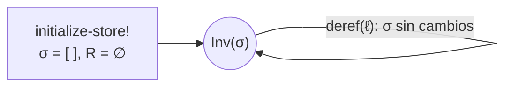
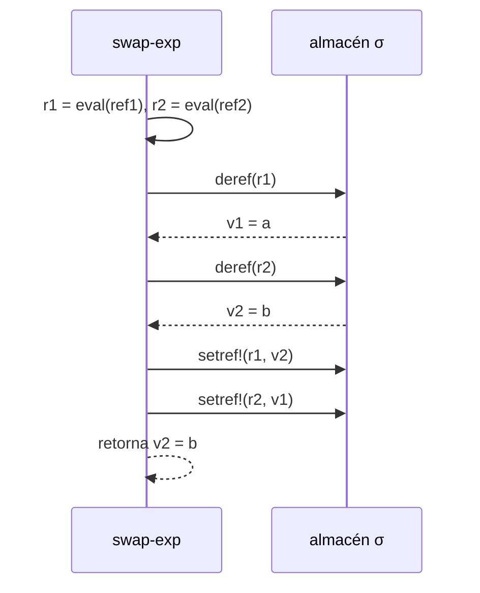
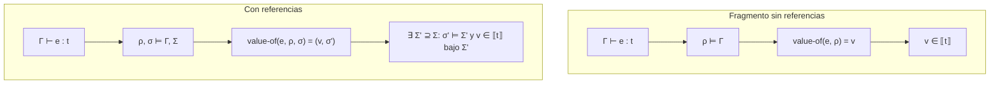

# Informe de corrección — Taller 3: Memoria y disciplina
## Curso: Fundamentos de Interpretación y Compilación de Lenguajes de Programación
Institución: Universidad del Valle, Sede Tuluá

Integrantes del grupo:
| Nombre completo | Código | Correo institucional |
|---|---|---|
| Andres Felipe Quiceno Gil | 2477362 | quiceno.andres@correounivalle.edu.co |
| Yonier Alejandro Vega Rojas | 2477056 | yonier.vega@correounivalle.edu.co |
| Jhon Fabricio Hurtado Marin | 2459472 | hurtado.jhoan@correounivalle.edu.co |
| Juan Esteban Aguirre Castañeda | 2459676 | juan.esteban.aguirre@correounivalle.edu.co |

## 1. Marco formal

### 1.1 Corrección de programas recursivos

Sea $f: A\to B$ una función definida sobre estructuras recursivas, y sea $P_f$ su implementación. Para las entradas del dominio en las que el algoritmo termina, la corrección funcional se expresa como:

$$
\forall a\in A,\quad P_f(a)\downarrow\ \Longrightarrow\ P_f(a)=f(a).
$$

La notación $P_f(a)\downarrow$ indica que el cálculo termina. Para justificar esta propiedad usamos inducción estructural: primero demostramos los casos básicos y después los casos compuestos, suponiendo que las llamadas recursivas sobre las subestructuras satisfacen la especificación. En este taller aplicamos ese razonamiento a `reemplazar-en`, que recorre una lista, y a las reglas de tipado, que siguen la estructura de las expresiones del lenguaje.

La terminación se justifica por separado, identificando una medida que disminuya en las llamadas recursivas. En `reemplazar-en`, cuando el índice es válido, disminuyen la posición pendiente y la longitud de la cola por procesar.

### 1.2 Corrección de programas iterativos

Para una transformación de estados, una invariante $\operatorname{Inv}(s)$ se utiliza mediante cuatro elementos:

1. **Inicialización:** el estado inicial $s_0$ satisface $\operatorname{Inv}(s_0)$.
2. **Preservación:** si el estado actual satisface la invariante, cada operación permitida produce otro estado que también la satisface.
3. **Postcondición:** al terminar, la invariante y la condición de finalización permiten establecer el resultado esperado.
4. **Terminación:** si existe un ciclo, se demuestra que alguna medida bien fundada disminuye hasta alcanzar su condición de salida.

Aunque el almacén del proyecto no se implementa como un ciclo iterativo, podemos razonar sobre una secuencia de operaciones que va modificando su estado. La idea de invariante es la misma: comprobar que `newref!`, `setref!` y `deref` respetan las propiedades requeridas después de cada operación.

## 2. Funciones analizadas

Para las demostraciones representamos el almacén inicializado como una lista finita

$$
\sigma=[v_0,v_1,\ldots,v_{n-1}],\qquad n=|\sigma|,
$$

y una referencia como `a-ref(i)`, donde $i$ es la posición de una celda. Los índices válidos pertenecen al conjunto $\{0,\ldots,n-1\}$.

**Notación.** Para $\ell=\operatorname{a\text{-}ref}(i)$ escribimos $\sigma(\ell)=\sigma(i)$ y decimos que $\ell$ es *válida* en $\sigma$ si $0\leq i<|\sigma|$. El conjunto de referencias válidas es

$$
\operatorname{Val}(\sigma)=\{\operatorname{a\text{-}ref}(i)\mid 0\leq i<|\sigma|\}.
$$

### 2.1 Corrección de `newref!`

**Especificación**

- Contrato: `newref! : valor -> referencia`.
- Precondición: el almacén $\sigma$ está inicializado, es finito y cumple las propiedades del almacén.
- Postcondición: para un valor $v$, si $n=|\sigma|$, se devuelve $\ell=\operatorname{a\text{-}ref}(n)$ y el nuevo almacén cumple:

$$
|\sigma'|=n+1,\qquad
\sigma'(\ell)=v,\qquad
\forall \ell'\in\operatorname{Val}(\sigma)\ (\sigma'(\ell')=\sigma(\ell')).
$$

**Implementación** en `src/almacen.rkt`:

```racket
(define newref!
  (lambda (val)
    (let ((pos (length the-store)))
      (set! the-store (append the-store (list val)))
      (a-ref pos))))
```

**Demostración.** Antes de ejecutar `newref!`, el almacén contiene $n$ celdas y su última posición es $n-1$. La función calcula `pos` como $n$ y agrega el valor al final mediante `append`. Por la definición de concatenación de listas,

$$
\sigma'=\sigma\mathbin{+\!+}[v],\qquad |\sigma'|=n+1,
$$

y además $\sigma'(i)=\sigma(i)$ para $i<n$ y $\sigma'(n)=v$. Por tanto las primeras $n$ celdas conservan su contenido y la celda nueva contiene $v$. La referencia devuelta, `a-ref(n)`, es válida porque $0\leq n<n+1$.

**Terminación.** Las operaciones `length` y `append` trabajan sobre listas finitas y terminan después de recorrer una cantidad finita de elementos. La función no realiza llamadas recursivas propias.

**Conclusión.** `newref!` agrega exactamente una celda, retorna una referencia válida y conserva todas las celdas existentes.

### 2.2 Corrección de `setref!`

**Especificación**

- Contrato: `setref! : referencia × valor -> void` (el resultado de la asignación no se usa como valor del lenguaje).
- Precondición: $\ell=\operatorname{a\text{-}ref}(i)$ y $0\leq i<|\sigma|$.
- Postcondición: si $\sigma'=\operatorname{setref!}(\sigma,\ell,v)$, la longitud no cambia, $\sigma'(\ell)=v$ y $\sigma'(\ell')=\sigma(\ell')$ para todo $\ell'\neq\ell$. En términos de posiciones:

$$
|\sigma'|=|\sigma|,\qquad
\sigma'(j)=
\begin{cases}
v, & j=i,\\
\sigma(j), & j\ne i.
\end{cases}
$$

**Implementación** en `src/almacen.rkt`:

```racket
(define reemplazar-en
  (lambda (lst pos val)
    (if (zero? pos)
        (cons val (cdr lst))
        (cons (car lst)
              (reemplazar-en (cdr lst) (- pos 1) val)))))

(define setref!
  (lambda (ref val)
    (cases referencia ref
      (a-ref (pos)
        (if (posicion-valida? pos)
            (set! the-store (reemplazar-en the-store pos val))
            (eopl:error 'setref!
                        "Referencia fuera de rango: ~s" pos))))))
```

**Lema (`reemplazar-en`).** Si $0\leq i<|\lambda|$, entonces la lista $\lambda'=$ `(reemplazar-en` $\lambda$ $i$ $v$`)` cumple $|\lambda'|=|\lambda|$, $\lambda'(i)=v$ y $\lambda'(j)=\lambda(j)$ para $j\neq i$.

*Demostración por inducción sobre la posición $i$.*

**Caso base ($i=0$).** La expresión `(cons val (cdr lst))` sustituye el primer elemento por $v$ y mantiene intacta la cola. La lista resultante tiene la misma longitud que la original.

**Caso inductivo ($i>0$).** La función conserva `(car lst)` y aplica `reemplazar-en` sobre `(cdr lst)` con índice $i-1$. Por hipótesis inductiva, en esa cola se cambia exactamente la posición indicada y se conservan las demás. Al reconstruir la lista con `cons`, también se conserva el primer elemento. Por ello, en la lista completa solo cambia la celda $i$. $\square$

**Terminación.** En cada llamada recursiva se reduce el índice de búsqueda en una unidad y se procesa una cola más corta. Como el índice es válido, se alcanza el caso $i=0$ antes de agotar la lista.

**Caso de error.** Si $i<0$ o $i\geq|\sigma|$, `posicion-valida?` devuelve falso. Entonces `setref!` ejecuta `eopl:error` sin modificar `the-store`.

**Conclusión.** Por el lema, para toda referencia válida `setref!` preserva la longitud del almacén y modifica únicamente la celda solicitada.

### 2.3 Corrección de `deref`

**Especificación**

- Contrato: `deref : referencia -> valor`.
- Precondición de lectura exitosa: $\ell=\operatorname{a\text{-}ref}(i)$ y $0\leq i<|\sigma|$.
- Postcondición: devuelve $\sigma(i)$ sin cambiar el almacén:

$$
\operatorname{deref}(\sigma,\ell)=\sigma(i),\qquad\sigma'=\sigma.
$$

**Implementación** en `src/almacen.rkt`:

```racket
(define deref
  (lambda (ref)
    (cases referencia ref
      (a-ref (pos)
        (if (posicion-valida? pos)
            (list-ref the-store pos)
            (eopl:error 'deref
                        "Referencia fuera de rango: ~s" pos))))))
```

**Demostración.** Si la posición $i$ es válida, `list-ref` recupera exactamente el elemento en esa posición. La función no ejecuta ninguna asignación ni llama a operaciones que escriban en el almacén, por lo que $\sigma'=\sigma$.

Si $i$ está fuera de rango, el código ejecuta `eopl:error` y evita invocar `list-ref` con una posición inválida. La lectura de una posición válida termina porque la lista es finita.

**Conclusión.** `deref` lee el contenido correcto sin modificar el almacén y rechaza mediante `eopl:error` las referencias cuya posición está fuera de rango.

## 3. Propiedades adicionales

### 3.1 El almacén preserva su invariante (Parte 5.1)

**Estado y variable fantasma.** Cada ejecución comienza con `initialize-store!`. Para poder hablar de «las referencias que entregó `newref!`» usamos una variable fantasma $R$ (no existe en el código): el conjunto de referencias entregadas por `newref!` desde el último `initialize-store!`. El estado es el par $(\sigma,R)$. La inicialización lo deja en $([\,],\emptyset)$, `newref!` añade a $R$ la referencia que entrega y las demás operaciones no modifican $R$.

**El invariante.** $\operatorname{Inv}(\sigma)$ (con $R$ implícito) es la conjunción de las cuatro condiciones del enunciado:

1. **(I1) Referencias entregadas válidas.** $R\subseteq\operatorname{Val}(\sigma)$: toda referencia entregada por `newref!` apunta a una posición existente.
2. **(I2) Solo `newref!` crea celdas.** $\operatorname{Val}(\sigma)\subseteq R$: toda celda existe porque `newref!` la creó y entregó su referencia. Junto con (I1), $R=\operatorname{Val}(\sigma)$ y $|\sigma|$ es el número de llamadas a `newref!`; ninguna otra operación cambia la longitud.
3. **(I3) Escritura localizada.** Para todo $\ell\in\operatorname{Val}(\sigma)$ y todo valor $v$, si $\sigma'=\operatorname{setref!}(\sigma,\ell,v)$, entonces
$$
|\sigma'|=|\sigma|,\qquad \sigma'(\ell)=v,\qquad
\forall\ell'\in\operatorname{Val}(\sigma)\ \bigl(\ell'\neq\ell\Rightarrow\sigma'(\ell')=\sigma(\ell')\bigr).
$$
4. **(I4) Lectura segura.** Si $\ell\in\operatorname{Val}(\sigma)$, `deref` devuelve $\sigma(\ell)$ y deja el almacén igual; si $\ell=\operatorname{a\text{-}ref}(i)$ con $i\notin\{0,\ldots,|\sigma|-1\}$, `deref` levanta `eopl:error`.



**Teorema.** `initialize-store!` establece $\operatorname{Inv}$, y cada una de las operaciones `newref!`, `setref!` y `deref` la preserva: si $\operatorname{Inv}(\sigma)$ y la operación termina con el estado $(\sigma',R')$, entonces $\operatorname{Inv}(\sigma')$.

**Demostración.**

*Observación previa.* (I3) e (I4) describen el comportamiento de `setref!` y `deref` sobre el almacén actual, para todo $\ell$ y todo $v$. Las secciones 2.2 y 2.3 las demuestran para cualquier lista finita $\sigma$, sin depender de cómo se llegó a ella. Por eso valen en todo estado y se preservan trivialmente; el trabajo real de cada caso está en (I1) e (I2), que relacionan $\sigma$ con $R$.

*`initialize-store!`.* $\sigma_0=[\,]$ y $R_0=\emptyset$. Como $\operatorname{Val}([\,])=\emptyset=R_0$, (I1) e (I2) se cumplen; (I3) e (I4) por la observación previa.

*`newref!`.* Sea $n=|\sigma|$, $\ell=\operatorname{a\text{-}ref}(n)$, $\sigma'=\sigma\mathbin{+\!+}[v]$ y $R'=R\cup\{\ell\}$. Por la sección 2.1, $|\sigma'|=n+1$, $\sigma'(\ell)=v$ y $\sigma'(\ell')=\sigma(\ell')$ para toda $\ell'\in\operatorname{Val}(\sigma)$; es decir, agrega exactamente una celda, retorna una referencia válida y no altera las existentes.
- (I1): cada referencia de $R$ era válida en $\sigma$ y $|\sigma|<|\sigma'|$, así que sigue válida; y $\ell$ es válida en $\sigma'$ porque $n<n+1$.
- (I2): $\operatorname{Val}(\sigma')=\operatorname{Val}(\sigma)\cup\{\ell\}\subseteq R\cup\{\ell\}=R'$.

*`setref!`.* Si $\ell\in\operatorname{Val}(\sigma)$, por la sección 2.2 $|\sigma'|=|\sigma|$ y $R'=R$. Como (I1) e (I2) solo dependen de $|\sigma|$ y de $R$, se mantienen. Además, la condición de las celdas no tocadas es exactamente (I3): $\sigma'(\ell)=v$ y $\sigma'(\ell')=\sigma(\ell')$ para todo $\ell'\neq\ell$. Si $\ell\notin\operatorname{Val}(\sigma)$, setref! levanta eopl:error antes de escribir; no hay estado resultante y el invariante se mantiene trivialmente (el estado no cambió).

*`deref`.* Por la sección 2.3, $\sigma'=\sigma$ y $R'=R$, así que (I1) a (I4) se conservan idénticas. $\square$

**Conclusión.** Por inducción sobre el número de operaciones de una ejecución, $\operatorname{Inv}$ vale en todo estado alcanzable desde `initialize-store!`. En particular, las referencias creadas durante una ejecución nunca quedan fuera de rango por una lectura o escritura posterior.

### 3.2 Corrección de `swap-exp` (Parte 5.2)

**Especificación.** Una vez evaluados los dos operandos de `swap`, sean $\ell_1=\operatorname{a\text{-}ref}(i)$ y $\ell_2=\operatorname{a\text{-}ref}(j)$ sus referencias, $\sigma$ el almacén en ese momento, $a=\sigma(\ell_1)$ y $b=\sigma(\ell_2)$. Si ambas referencias son válidas, y $\sigma'$ es el almacén después de $\operatorname{swap}(\ell_1,\ell_2)$ con resultado $r$, debe cumplirse:

$$
\sigma'(\ell_1)=\sigma(\ell_2),\qquad
\sigma'(\ell_2)=\sigma(\ell_1),\qquad
\forall \ell\in\operatorname{Val}(\sigma)\setminus\{\ell_1,\ell_2\},\ \sigma'(\ell)=\sigma(\ell),
$$

$$
|\sigma'|=|\sigma|,\qquad r=\sigma(\ell_2).
$$

La especificación se toma después de evaluar los operandos porque estos, al ser expresiones, podrían producir cambios en el almacén antes del intercambio. Cuando $\ell_1=\ell_2$, las dos primeras igualdades exigen $\sigma'(\ell_1)=\sigma(\ell_1)$, es decir, que el almacén no cambie.

**Implementación** verificada en `src/interprete.rkt`:

```racket
(swap-exp (ref1 ref2)
  (let* ((r1 (evaluar-expresion ref1 env))
         (r2 (evaluar-expresion ref2 env)))
    (if (and (referencia? r1) (referencia? r2))
        (let ((v1 (deref r1))
              (v2 (deref r2)))
          (setref! r1 v2)
          (setref! r2 v1)
          v2)
        (eopl:error 'evaluar-expresion
                    "swap espera dos referencias, se encontro ~s y ~s"
                    r1 r2))))
```



**Observaciones sobre el código.** (O1) Las dos lecturas `deref` ocurren antes de cualquier escritura; por (I4) no modifican el almacén, así que su orden no importa y tanto $v_1=a$ como $v_2=b$ quedan guardados. (O2) Las dos escrituras usan (I3).

**Demostración cuando $\ell_1\neq\ell_2$.** Sea $\sigma_1=\operatorname{setref!}(\sigma,\ell_1,b)$ y $\sigma'=\operatorname{setref!}(\sigma_1,\ell_2,a)$.

- Por (I3) en la primera escritura: $\sigma_1(\ell_1)=b$ y $\sigma_1(\ell)=\sigma(\ell)$ para $\ell\neq\ell_1$; en particular $\sigma_1(\ell_2)=\sigma(\ell_2)$.
- Por (I3) en la segunda: $\sigma'(\ell_2)=a=\sigma(\ell_1)$ y $\sigma'(\ell)=\sigma_1(\ell)$ para $\ell\neq\ell_2$. Como $\ell_1\neq\ell_2$, $\sigma'(\ell_1)=\sigma_1(\ell_1)=b=\sigma(\ell_2)$.
- Para $\ell\notin\{\ell_1,\ell_2\}$: $\sigma'(\ell)=\sigma_1(\ell)=\sigma(\ell)$.
- Cada escritura conserva la longitud, luego $|\sigma'|=|\sigma|$.

**El valor original de la primera celda no se pierde.** La primera escritura destruye el contenido $a$ de $\ell_1$, pero $a$ ya estaba guardado en `v1` por (O1) y la segunda escritura lo deposita en $\ell_2$: $\sigma'(\ell_2)=a$. Una versión ingenua que leyera $\ell_1$ después de escribirla, como `(setref! r1 (deref r2)) (setref! r2 (deref r1))`, copiaría $b$ en ambas celdas y perdería $a$. Por eso el código guarda $v_1$ y $v_2$ antes de escribir.

**Caso $\ell_1=\ell_2$ (aliasing).** Sea $\ell=\ell_1=\ell_2$ y $a=\sigma(\ell)$. La especificación exige $\sigma'(\ell)=\sigma(\ell)$ y que las demás celdas se conserven, es decir, $\sigma'=\sigma$. En la implementación, `v1` y `v2` valen ambos $a$. La primera escritura produce $\sigma_1$ con $\sigma_1(\ell)=a=\sigma(\ell)$ y las demás celdas iguales por (I3), luego $\sigma_1=\sigma$; la segunda escritura repite el argumento y da $\sigma'=\sigma_1=\sigma$. El intercambio de una celda consigo misma no altera nada, como exige la especificación.

**Valor retornado.** La expresión devuelve `v2`. Por (O1), `v2` se lee con `deref` antes de cualquier escritura, así que `v2` $=\sigma(\ell_2)$, el contenido anterior de la segunda celda. Esto vale también si $\ell_1=\ell_2$, donde $\sigma(\ell_2)=a$. Como además $\sigma'(\ell_1)=\sigma(\ell_2)$, el valor retornado coincide con el que quedó en la primera referencia, que es la forma en que el enunciado describe el resultado.

**Operandos inválidos.** Si algún operando no es referencia, el `if` ejecuta `eopl:error` antes de cualquier `deref` o `setref!`. Si es una referencia fuera de rango, el `deref` correspondiente levanta `eopl:error` por (I4) antes de la primera escritura. En ambos casos el almacén queda intacto.

**Terminación.** El código no tiene recursión ni ciclos propios; solo invoca `deref` y `setref!`, que terminan (secciones 2.2 y 2.3).

**Conclusión.**  La implementación de swap-exp en src/interprete.rkt evalúa los operandos, comprueba que sean referencias, guarda los dos contenidos originales, los intercambia mediante setref! y retorna el segundo valor original. Por las propiedades del almacén, la implementación cumple el intercambio, conserva las demás celdas, maneja el aliasing y retorna el contenido anterior de la segunda celda.

### 3.3 Solidez del chequeador de tipos (Parte 5.3)

**Valores de cada tipo.** Para el fragmento sin referencias (los tipos son `num`, `bool` y los de procedimiento), definimos por recursión sobre la estructura del tipo el conjunto $\llbracket t\rrbracket$ de los valores que lo habitan:

- $\llbracket\mathrm{num}\rrbracket$ son los valores numéricos del lenguaje y $\llbracket\mathrm{bool}\rrbracket=\{\#t,\#f\}$.
- $\llbracket(t_1*\cdots*t_n\to t)\rrbracket$ son las clausuras $c=(x_1\ldots x_n,\,\text{cuerpo},\,\rho_c)$ con $n$ parámetros tales que, para todos $v_1\in\llbracket t_1\rrbracket,\ldots,v_n\in\llbracket t_n\rrbracket$, si el cuerpo evaluado en $\rho_c[x_i\mapsto v_i]$ termina normalmente, su valor pertenece a $\llbracket t\rrbracket$.

La definición no es circular: la cláusula de procedimientos solo usa $\llbracket t_i\rrbracket$ y $\llbracket t\rrbracket$ de tipos estructuralmente menores.

**Concordancia entre $\rho$ y $\Gamma$.** Escribimos $\rho\models\Gamma$ cuando, para todo identificador $x$ declarado en $\Gamma$, el ambiente $\rho$ lo define y

$$
\rho(x)\in\llbracket\Gamma(x)\rrbracket .
$$

Como $\rho$ y $\Gamma$ se construyen en paralelo con las mismas tres variantes (vacío, extendido, recursivo), la búsqueda encuentra en ambos la ligadura más interna, de modo que el sombreado no rompe la correspondencia. Por casos:

- `tenv-vacio` concuerda con el ambiente vacío (no hay nada que exigir).
- Si $\Gamma=$ `tenv-extendido`$(x_1\ldots x_k,\,t_1\ldots t_k,\,\Gamma')$, entonces $\rho\models\Gamma$ cuando $\rho$ extiende un $\rho'\models\Gamma'$ con valores $v_i\in\llbracket t_i\rrbracket$.
- Si $\Gamma=$ `tenv-recursivo`$(f_1\ldots f_k,\,t_1\ldots t_k,\,\Gamma')$, entonces $\rho\models\Gamma$ cuando $\rho$ extiende un $\rho'\models\Gamma'$ con clausuras recursivas en $\llbracket t_j\rrbracket$.

El programa se chequea en el ambiente inicial $\Gamma_0$ (`tenv-inicial`, con $n,m,p,q,r:\mathrm{num}$); el resultado se aplica a programas completos suponiendo que el ambiente inicial de valores $\rho_0$ liga esas cinco variables a números, es decir, $\rho_0\models\Gamma_0$.

**Enunciado.** Si $\Gamma\vdash e:t$, $\rho\models\Gamma$ y la evaluación de $e$ en $\rho$ termina normalmente con valor $v$, entonces $v\in\llbracket t\rrbracket$:

$$
\Gamma\vdash e:t\ \land\ \rho\models\Gamma
\quad\Longrightarrow\quad
\operatorname{value\text{-}of}(e,\rho)\in\llbracket t\rrbracket,
\quad\text{si la evaluación termina normalmente}.
$$

«Termina normalmente» significa que produce un valor, sin divergir (`letrec` permite recursión sin fin) y sin errores de ejecución que no son de tipo, como una división por cero.

**Demostración.** Por inducción sobre la derivación de $\Gamma\vdash e:t$, para todo $\rho$ con $\rho\models\Gamma$. Mostramos los dos casos solicitados.

**Caso `if`.** La regla es

$$
\frac{\Gamma\vdash e_1:\mathrm{bool}\qquad
      \Gamma\vdash e_2:t\qquad
      \Gamma\vdash e_3:t}
     {\Gamma\vdash \mathrm{if}\ e_1\ \mathrm{then}\ e_2\ \mathrm{else}\ e_3\ \mathrm{end}:t}.
$$

Si el `if` termina normalmente, también terminan normalmente la evaluación de $e_1$ y la de la rama elegida. Por hipótesis inductiva sobre $e_1$ (con el mismo $\rho$), $v_1\in\llbracket\mathrm{bool}\rrbracket$, así que $v_1$ es $\#t$ o $\#f$ y el intérprete elige exactamente una rama. Si es $\#t$, la hipótesis inductiva sobre $e_2$ da $v\in\llbracket t\rrbracket$; si es $\#f$, la de $e_3$ da lo mismo. Como la regla exige que ambas ramas tengan el mismo tipo $t$, el resultado está en $\llbracket t\rrbracket$ sin importar cuál rama se ejecute. $\square$

**Caso `apply`.** La regla es

$$
\frac{\Gamma\vdash f:(t_1*\cdots*t_n\to t)\qquad
      \Gamma\vdash e_i:t_i\quad (1\leq i\leq n)}
     {\Gamma\vdash \operatorname{apply}\ f(e_1,\ldots,e_n):t}.
$$

Supongamos que la aplicación termina normalmente; entonces terminan normalmente el operador, los operandos y el cuerpo de la clausura.

1. Por hipótesis inductiva sobre $f$, su valor es una clausura $c=(x_1\ldots x_n,\,\text{cuerpo},\,\rho_c)$ en $\llbracket(t_1*\cdots*t_n\to t)\rrbracket$. En particular tiene exactamente $n$ parámetros, que es la aridad que verifica el chequeador.
2. Por hipótesis inductiva sobre cada $e_i$, su valor $v_i$ cumple $v_i\in\llbracket t_i\rrbracket$.
3. El intérprete evalúa el cuerpo en $\rho_c[x_i\mapsto v_i]$. En el fragmento sin referencias los argumentos se pasan por valor, así que los $v_i$ se ligan tal cual.
4. Por la definición de $\llbracket(t_1*\cdots*t_n\to t)\rrbracket$, como los $v_i$ están en $\llbracket t_i\rrbracket$ y el cuerpo termina normalmente, su valor pertenece a $\llbracket t\rrbracket$. $\square$

Nota: el caso `proc` es el que justifica que una clausura recién creada esté en $\llbracket(t_1*\cdots*t_n\to t)\rrbracket$ (por hipótesis inductiva sobre el cuerpo con el ambiente extendido). Para `letrec`, cuyas clausuras se contienen a sí mismas, el argumento completo necesita además inducción sobre el número de pasos de la evaluación; no se desarrolla aquí.

**¿Qué cambia al incorporar referencias?**



1. **El valor ya no basta para saber su tipo.** Un valor $\operatorname{a\text{-}ref}(i)$ pertenece a $\llbracket\operatorname{refto}(t)\rrbracket$ solo si la celda $i$ existe y su contenido es de tipo $t$. Eso depende del almacén, no solo del valor ni de $\rho$: la pertenencia pasa a ser $\llbracket t\rrbracket_\sigma$.
2. **Hace falta un tipado del almacén $\Sigma$** que asigne un tipo a cada posición, y una consistencia entre ambientes, almacén y tipos:

$$
\rho,\sigma\models\Gamma,\Sigma
\quad\Longleftrightarrow\quad
\rho\models\Gamma\ \land\ |\sigma|=|\Sigma|\ \land\ \forall i<|\sigma|,\ \sigma(i)\in\llbracket\Sigma(i)\rrbracket .
$$

3. **La evaluación tiene efectos, así que el enunciado devuelve un almacén nuevo.** La solidez pasa a decir que, si $\Gamma\vdash e:t$ y $\rho,\sigma\models\Gamma,\Sigma$, la evaluación produce $(v,\sigma')$ y existe $\Sigma'\supseteq\Sigma$ con $\sigma'\models\Sigma'$ y $v\in\llbracket t\rrbracket$ bajo $\Sigma'$. La extensión $\Sigma'\supseteq\Sigma$ es necesaria porque `newref` agrega celdas (`newref` extiende $\Sigma$ con el tipo de su argumento) y nunca cambia el tipo de las existentes. Por eso las subexpresiones se evalúan encadenando el almacén (`begin`, argumentos de `setref`) y los valores ya obtenidos deben seguir siendo del mismo tipo bajo el $\Sigma'$ posterior.
4. **Las clausuras también cambian.** Su cuerpo puede reservar o escribir celdas, así que $\llbracket(t_1*\cdots*t_n\to t)\rrbracket$ debe cuantificar sobre todos los almacenes consistentes con alguna $\Sigma'\supseteq\Sigma$, no solo sobre el valor de los argumentos.
5. **Las reglas de `setref` y `swap` sostienen la consistencia.** Como $\Gamma\vdash e_1:\operatorname{refto}(t)$ y $\Gamma\vdash e_2:t$, escribir $e_2$ en la celda de $e_1$ conserva $\sigma\models\Sigma$; esto se apoya en la escritura localizada (I3) de la sección 3.1, que garantiza que ninguna otra celda cambia. En `swap` ambas celdas contienen tipo $t$, así que intercambiarlas tampoco rompe $\Sigma$. Además `refto(t)` es invariante: el chequeador compara tipos con igualdad estructural y no hay subtipos, de modo que dos nombres para la misma celda (alias, `applyref`) siempre la ven con el mismo tipo. Por último, `setref` retorna $1$ (tipo `num`) y `swap` retorna `v2`, de tipo $t$, tal como los tipa el chequeador.

**Conclusión.** Los casos `if` y `apply` muestran cómo las reglas del chequeador y la evaluación preservan el tipo de las expresiones en el fragmento sin referencias, una vez precisada la concordancia entre $\rho$ y $\Gamma$. Esta es una justificación informal de los casos solicitados, no una demostración exhaustiva de todos los constructores. El argumento presupone que las reglas de tipado de las primitivas y sus controles de ejecución son compatibles. Para extenderlo al lenguaje con referencias es necesario mantener, además, la consistencia entre $\sigma$ y $\Sigma$.

## 4. Referencias

- Delgado S., C. A. (2026). Taller 3: Memoria y disciplina. Fundamentos de Interpretación y Compilación de Lenguajes de Programación, Universidad del Valle.
- Friedman, D. P., & Wand, M. (2008). *Essentials of Programming Languages* (3.ª ed.). MIT Press. Capítulo 4, secciones 4.2 y 4.3; capítulo 7, secciones 7.1 a 7.3.
- Pierce, B. C. (2002). *Types and Programming Languages*. MIT Press. Capítulos 8 y 13.